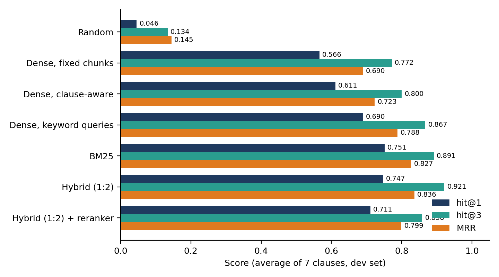
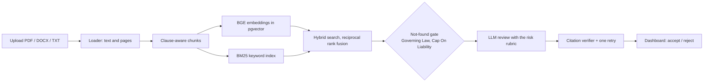
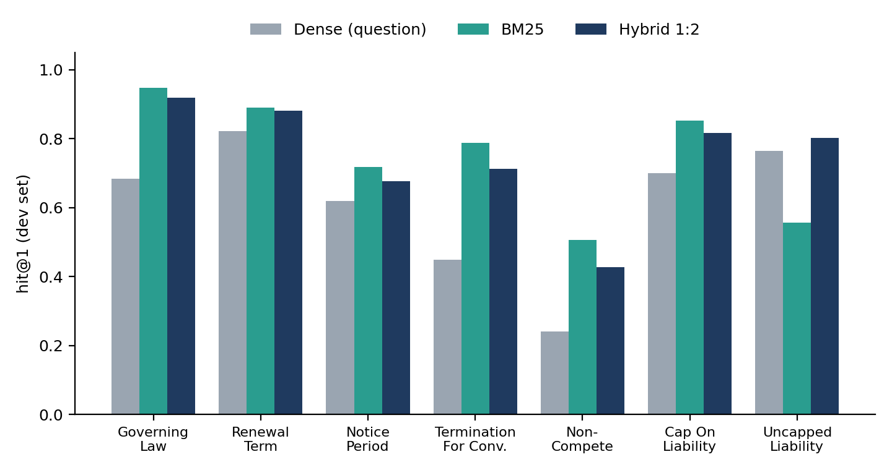

# Contract Risk & Compliance Reviewer

A retrieval-augmented system that reads a contract, finds eight key clauses, rates each one **Low / Medium / High** risk from the customer's side, quotes the **exact contract text** as proof, and suggests safer wording. A person stays in the loop: every finding can be accepted or rejected.

> **Decision support only. This is not legal advice.** Risk rules are simplified conventions written by the author.


## Why this project

Reviewing contracts for risky clauses is slow, expensive and error-prone. Auto-renewal traps, uncapped liability, one-sided termination rights, hidden non-competes and unfavorable court locations are easy to miss. This project is not a prompt wrapped around a language model. It is a measured retrieval pipeline: every design choice was compared with a baseline on a lawyer-labeled benchmark, and every quote shown to the user is verified against the source text by code.

## Key results

All retrieval numbers are on the **development set** (357 contracts), averaged over seven clauses. The 153-contract test set is held out.

| Measure | Result |
|---|---|
| Benchmark | CUAD: 510 contracts, 13,000+ lawyer annotations |
| Random chunk (hit@1) | 0.046 |
| Baseline: dense search on fixed-size chunks (hit@1) | 0.566 |
| **Final: hybrid search on clause-aware chunks (hit@1 / hit@3 / MRR)** | **0.747 / 0.921 / 0.836** |
| Chunks to search, fixed vs clause-aware | 23,810 vs 18,109 (24% fewer) |
| Search inside one contract in PostgreSQL | 1.13 ms median |
| Search across 21,132 chunks, exact scan vs HNSW index | 39.09 ms vs 1.1 ms (recall@10 = 1.0 on 7 queries) |
| Cross-encoder reranker (tested, **rejected**) | hit@1 fell from 0.747 to 0.711 |
| Clause-absent test: contracts with no such clause | model claimed a clause in 4 of 46 that reached it (8.7%, 95% CI 3.4% to 20.3%) |
| Automated tests | 47 passing |



<!-- TODO: after the final evaluation run, add rows for risk-rating accuracy on the 48 hand labels (from eval/llm_eval_dev.json) and for the held-out test results. -->

## Features

- **Eight clauses:** Governing Law, Renewal Term (auto-renewal), Notice Period To Terminate Renewal, Termination For Convenience, Non-Compete, Cap On Liability, Uncapped Liability, Indemnification.
- **Structured findings:** risk level, plain-language explanation, exact quote with its position, and suggested safer wording.
- **Grounded quotes:** a verifier checks each quote word for word against the contract. A failed check triggers one retry, then the clause is shown as "could not verify, review manually". It is never silently turned into "not found".
- **"Clause not found" handling:** a score gate for the two clauses where it works well (Governing Law and Cap On Liability), plus the model's own not-found answer and the verifier.
- **Clickable citations:** the interface highlights the quoted text inside the contract.
- **Human in the loop:** accept or reject each finding.
- **Uploads:** PDF, DOCX or TXT up to 15 MB, with page numbers; scanned PDFs without text are rejected with a clear message.
- **Evaluation page:** measured results shown in the app.

## How it works



| Stage | What it does | Code |
|---|---|---|
| Chunking | Splits at numbered headings into pieces of up to 1,500 characters. Text is never altered, so character positions stay exact. | `src/chunking.py` |
| Dense search | `BAAI/bge-small-en-v1.5` embeddings (384 dimensions) with cosine similarity, stored in PostgreSQL with pgvector | `src/embed.py`, `src/db.py` |
| Keyword search | BM25 with a keyword list per clause; negations such as "not" and "no" are kept | `src/bm25.py` |
| Fusion | Reciprocal rank fusion, BM25 weighted 2 | `src/hybrid.py` |
| Gate | BM25 score threshold keeping 95% of real clauses | `src/abstain.py` |
| Review | The model gets the top 3 chunks, the risk rules for that clause (read from `eval/labeling_rubric.md`) and the customer's name | `src/generate.py`, `src/llm.py` |
| Verification | Whitespace- and case-insensitive word-for-word match, returns exact positions | `src/verify.py`, `src/schema.py` |
| Pipeline | One function runs all eight clauses | `src/pipeline.py` |

## Evaluation highlights

### Hybrid search is the main improvement

| System | hit@1 | hit@3 | MRR |
|---|---|---|---|
| Random chunk | 0.046 | 0.134 | 0.145 |
| Dense, fixed chunks | 0.566 | 0.772 | 0.690 |
| Dense, clause-aware chunks | 0.611 | 0.800 | 0.723 |
| Dense, keyword-style queries | 0.690 | 0.867 | 0.788 |
| BM25 | 0.751 | 0.891 | 0.827 |
| **Hybrid (BM25 weighted 2)** | 0.747 | **0.921** | **0.836** |
| Hybrid + cross-encoder reranker | 0.711 | 0.858 | 0.799 |

The review step reads the top three chunks, so hit@3 matters most: the right chunk is in the top three about 92% of the time.

### What the experiments taught

- **Measure first.** Scoring code and a random baseline were written before any search model, so each change could be judged.
- **Chunking by clause helps.** Four settings were compared; max 1,500 characters was best on average. Two clauses (Notice Period, Non-Compete) got slightly worse, which is reported, not hidden.
- **A fairness check changed the story.** BM25 used hand-written keywords. Giving dense search the same wording lifted it from 0.611 to 0.690 hit@1, which explains about 8 of BM25's 14 points of lead.
- **The reranker did not help.** It was dropped because the numbers said so.
- **The score alone cannot say "not found" for most clauses.** AUC ranged from 0.68 (Termination For Convenience) to 0.985 (Governing Law), so the gate is used only for two clauses.
- **Quotes are grounded, but classification errors remain.** In the clause-absent test, the model sometimes labeled a nearby clause type (exclusivity, indemnity, a conditional termination right) as the target clause. All 4 such quotes were real contract text.



### Methodology

- **Split by company:** 357 development and 153 test contracts, with no company in both sets, because CUAD contains near-duplicate filings from the same company. The split and seed are in `eval/split.json`.
- **Test set locked:** all choices (chunk size, fusion weights, thresholds, prompts) were made on the development set only.
- **Risk labels:** CUAD has no risk levels, so 48 clauses (6 for each of 8 clauses) were hand-labeled blind against a numeric rubric (`eval/labeling_rubric.md`). With 48 items the uncertainty is roughly plus or minus 12 points, so per-clause results are reported as counts.
- **Honest intervals:** language-model rates are reported with 95% Wilson confidence intervals and their sample sizes.

More detail is in [`docs/`](docs/) (full project documentation) and in `eval/error_analysis_dev.md`.

## Tech stack

| Layer | Technology |
|---|---|
| Language, tests | Python, pytest |
| Retrieval | sentence-transformers (BGE small), rank_bm25 |
| Database | PostgreSQL 16 + pgvector (HNSW index), Docker |
| Language model | Gemini through an OpenAI-compatible endpoint, temperature 0 (swappable through `.env`) |
| Validation | Pydantic |
| File reading | pdfplumber, python-docx |
| Backend | FastAPI, Uvicorn |
| Frontend | React, Vite |
| Heavy runs | Google Colab T4 GPU (embedding, reranking) |

## Getting started

**Prerequisites:** Python 3.12 or newer, Node.js (LTS), Docker Desktop, a language-model API key.

```bash
git clone https://github.com/khushalcodess/contract-reviewer.git
cd contract-reviewer
python -m venv .venv
.venv\Scripts\activate          # Windows PowerShell. On macOS/Linux: source .venv/bin/activate
pip install -r requirements.txt
```

**1. Configure.** Copy `.env.example` to `.env` and fill in your own values. Never commit `.env`.

```
LLM_API_KEY=
LLM_BASE_URL=
LLM_MODEL=
```

**2. Start the database** (Docker Desktop must be running):

```bash
docker compose up -d db
```

**3. Start the backend** (port 8000):

```bash
python -m uvicorn app.main:app --reload
```

**4. Start the interface** (port 5173), in a second terminal:

```bash
cd frontend
npm install
npm run dev
```

Open `http://localhost:5173`, upload a contract, and open the review.

**Run the tests:**

```bash
python -m pytest -q
```

**Reproduce the experiments.** Download CUAD v1 from the [Atticus Project](https://www.atticusprojectai.org/cuad) into `data/CUAD_v1/`, then run the numbered notebooks in `notebooks/`. Embeddings are cached in `data/cache`, so a contract is embedded once. A free Colab GPU speeds up the large embedding runs.

## Project structure

```
src/         retrieval, chunking, metrics, gate, review, verification, pipeline
app/         FastAPI application
frontend/    React + Vite interface
tests/       automated tests (language-model calls use a fake model)
notebooks/   numbered experiment notebooks, 01 to 21
eval/        result files, split, thresholds, labeling rubric, hand labels, error analysis
docs/        full project documentation and images
```

## Limitations

- **The risk rules are simplified conventions**, written by one person from the customer's side. They are not legal standards.
- **One annotator, 48 labels.** The uncertainty on risk accuracy is wide and cannot support per-clause percentages.
- **Development numbers are optimistic.** Fusion weights, thresholds, prompts and keyword lists were tuned on the development contracts.
- **CUAD text is cleaner than real files.** Real PDFs extract with layout noise, and scanned PDFs are not supported (no OCR).
- **Retrieval scoring is lenient:** a chunk touching a lawyer's highlight by one character counts as correct.
- **Indemnification has no benchmark labels.** Only its risk rating is checked, on a few hand labels.
- **Free-tier language models** follow strict rules less reliably than large models and have daily limits.
- **No login, no encryption at rest.** This is a demonstration application.

## Responsible use and privacy

- The tool supports a reviewer. It is not a lawyer, and a person must check every finding.
- Contract text is sent to a hosted language model. Free tiers may keep or use inputs, so **use public or sample contracts only**.
- Contract text is treated as untrusted input, and it is rendered as plain text in the interface.

## Roadmap

- Report prompt versions side by side, and add a stricter retrieval metric.
- Second hand-label set for the test split, with a second annotator and an agreement score.
- Try a legal-domain reranker, or combine reranker scores with the hybrid ranks.
- Compare embedding models and language models on quality and cost.
- OCR for scanned PDFs, a delete button, login, a job queue, and a choice of which party the user is.
- Full Docker Compose stack and cloud deployment.

## Acknowledgements

This project uses the **Contract Understanding Atticus Dataset (CUAD)**:

> Hendrycks, D., Burns, C., Chen, A., and Ball, S. *CUAD: An Expert-Annotated NLP Dataset for Legal Contract Review.* NeurIPS Datasets and Benchmarks, 2021.

Please check the dataset's license terms on the Atticus Project website before redistributing any of its data.

## Author

**Khushal Patil** ([@khushalcodess](https://github.com/khushalcodess))

<!-- Add a LICENSE file and state the license here before making the repository public. -->
